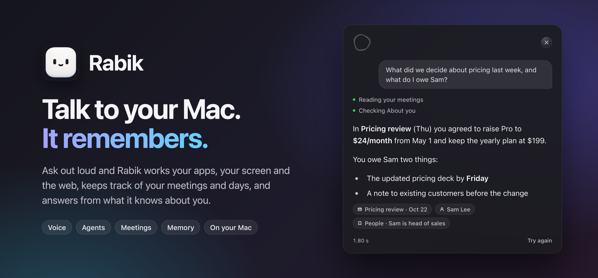
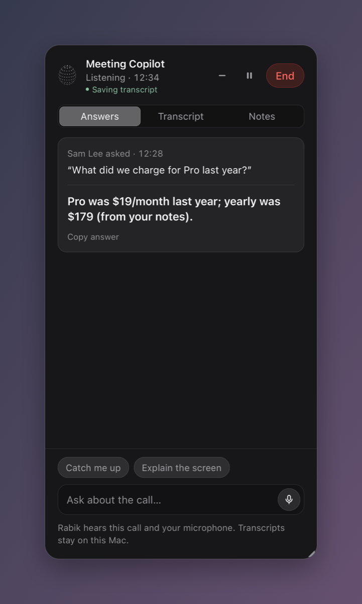
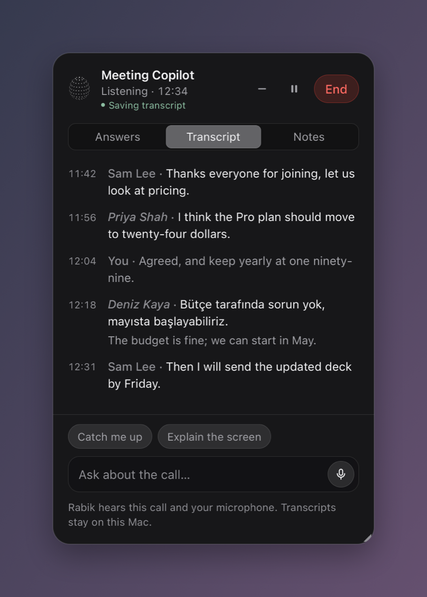
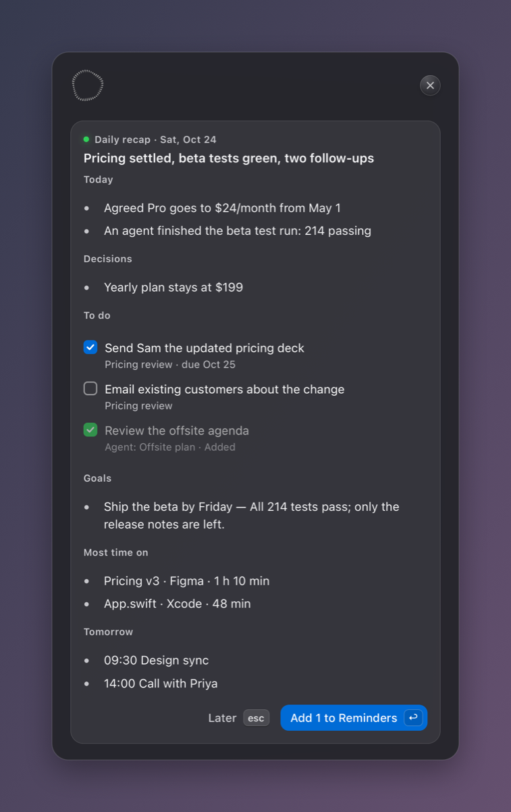
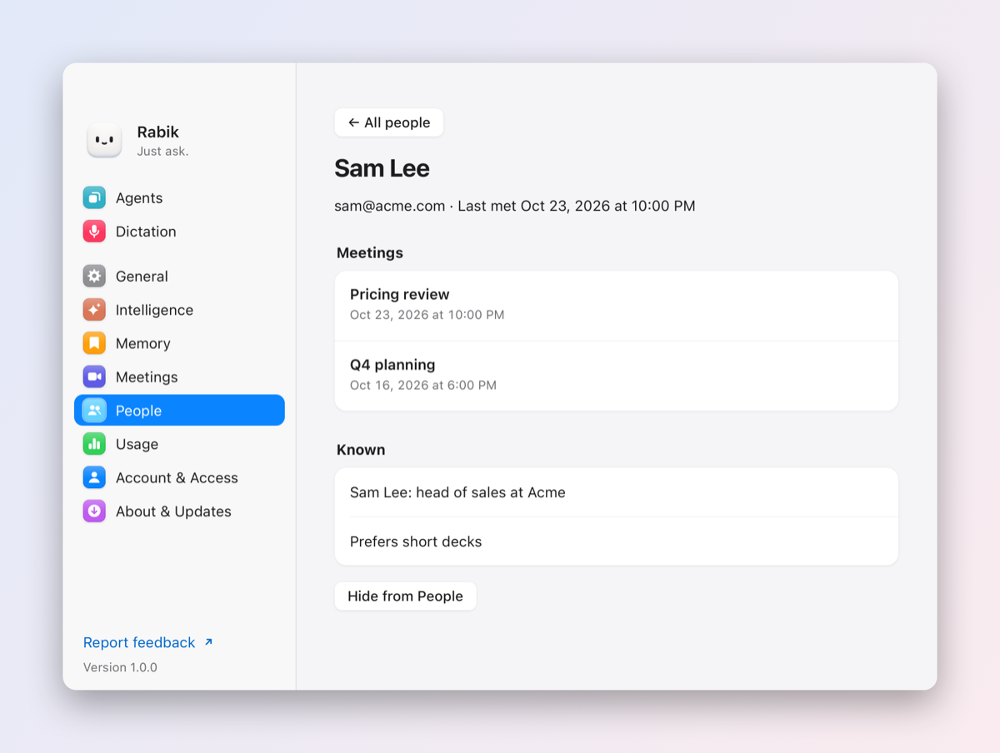

**Rabik is a Mac assistant you talk to.** Hold <kbd>⌃</kbd><kbd>⌥</kbd><kbd>Space</kbd>, say what you want and let go. Rabik works your apps, your screen and the web, sits in on your calls, and keeps a private memory of your days, so it can answer *"what did we decide last week?"* as easily as *"open Spotify"*.

[**Download for Mac**](https://github.com/sayginsaman/rabik/releases/latest) · macOS 26 or later · free and open source (MIT) · [Install notes](#install)

---

## A day with Rabik

<table>
<tr>
<td width="50%"> <b>During a call</b>, it answers the question someone just asked, from your notes.</td>
<td width="50%"> <b>In any language</b>, with speaker names and live translation, on your Mac.</td>
</tr>
<tr>
<td> <b>In the evening</b>, one card: what got done, to-dos for Reminders, your goals and where the time went.</td>
<td> <b>Any time</b>, ask about a person, a meeting or that page you had open on Tuesday.</td>
</tr>
</table>

## Things to say

| Say | What happens |
|---|---|
| *"Open Spotify."* · *"Terminal on the left."* | Done at once. Simple commands never touch the AI. |
| *"Code on my big screen, Chrome and Terminal on the laptop."* | Three windows arranged across two displays. |
| *"What's wrong with this code?"* | Rabik looks at your screen and answers in a line. |
| *"Where do I turn on Night Shift?"* | A ring appears on the exact spot. |
| *"Explain the Pythagorean theorem and draw it."* | A step-by-step drawing builds up over your screen. |
| *"Reply to this. Thursday works, send me a time."* | A draft of the reply, ready to insert. It never sends by itself. |
| *"Move my dentist appointment to 4."* | A card shows the old and new time. Adding is immediate; moving or deleting asks first. |
| *"Find me a desk lamp under $30 on Amazon."* | Rabik shops in Chrome behind your apps; a mini screen shows it. |
| *"Tell me when the build is done."* | Rabik watches for free and pings you. |
| *"When I say focus mode, close Slack and open my to-do list."* | Learned. Two words do it from now on. |
| *"When did I last talk to Sam?"* | An answer from your meetings, with chips that open them. |
| *"Summarize my day."* · *"My goal is to ship the beta by Friday."* | The daily recap, and a goal it keeps track of. |

## What it does

### Acts on your Mac
Rabik opens apps, places windows, plays music, searches the web, fills in forms, reads documents and types where your cursor is. The simplest commands run instantly with no AI. Anything new is worked out once by the AI; ask again and Rabik replays what worked, in a blink.

### Shows you, and lets you show it
**Point at your screen:** click the pointer button next to the mic, then click, circle or scribble on anything and ask about it. **Draw on screen** is the other direction: Rabik draws boxes, arrows and labels over your apps and walks you through, one step at a time. Ask it to explain something and the drawing builds up like a whiteboard.

More about pointing and drawing

- Another stroke near your mark replaces it; move away and your clicks reach your apps again. A small picture of the mark waits in the box until you send; Esc clears it.
- A guide moves on when you click the highlighted spot, change that value or say "next". Explanations step through by themselves, with every caption kept on a card in the opposite corner.
- Rabik works from what you have open: with a video, page or problem on screen, it marks up that figure and uses its numbers.
- Click any drawn mark and ask "how does this work?" to ask about that mark. Drawings never take focus; clicks pass through everywhere except on a mark. Esc clears them.
- Turn drawings off in Settings → General → Draw on screen to show you.

### Dictation anywhere
Hold <kbd>fn</kbd>, talk, let go: your words land in any text field. Double-tap to keep it on hands-free. **Verbatim** types Apple's on-device transcript as is; **Clean up** makes one quick AI pass that drops fillers and slips ("four, actually five" leaves five), turns spoken lists into lists and fixes words it clearly misheard, without ever answering what you said.

More about dictation

- Record another shortcut in Settings → Dictation: a key combo, an F-key or a chord like fn+Control. If macOS uses 🌐 for emoji or input sources, Settings offers a button to change that.
- Clean up spells names from your Dictionary and the text before your cursor, and starts while you talk so the text lands soon after you let go. Select text first and it tidies that text in place.
- Your clipboard stays yours: when a field only takes a paste, Rabik borrows the clipboard for that paste and puts back what you had copied. If it can't confirm the words landed, they go to Dictation History instead of being typed twice.
- The Dictation tab shows words today and all time, time saved, your dictionary and history.

### Works in the background
Big jobs go to **agents** that work behind your apps: a chip in the corner shows live steps and a mini screen, and a card shows the result when you stop typing. Steer one by talking to it ("tell the hub agent to check HDMI too"). Save **named agents** ("make an agent called Researcher that…"), schedule **routines** ("every weekday at 8, summarize my calendar") and set **watches** ("tell me when Codex is done") that check on your Mac for free.

More about agents, routines and watches

- Agents click, type and scroll straight into the app they work in, so your pointer, front app and Space stay put. Web work happens in the agent's own window in your signed-in Chrome profile, and closes when the task ends.
- A long ask in the box moves to an agent by itself; ⌃⌥↩ moves one sooner from any app. When an agent asks for something, **Always allow for this task** covers that kind of action until it ends.
- Routines are woken by macOS on time, cost nothing while they wait, run on Cheapest unless you choose otherwise and report back with a notification. Manage them in Settings → General → Scheduled routines.
- Watches poll a window or a coding agent's log every 5 seconds with no AI. A window must stay open on this desktop (covered is fine). Say "stop watching" to cancel.
- Agents and routines need Claude Code. With Pi or Devin, asks run in the foreground; Pi has no sandbox, so Safe mode asks before every shell command.

### Meeting Copilot
Turn it on in Settings → Meetings. When a call app starts using your mic, Rabik offers to listen. It transcribes both sides on your Mac, answers questions someone asks from your notes and files, and ends with a recap and action items you can share or send to Reminders.

More about meetings

- **Language:** pick what the call is in, or Automatic for your Mac's language; languages Apple's transcription model lacks (Turkish, for one) use its dictation model. **Translate the call** puts the other side's lines, in your language, under each line.
- **Names:** a calendar call with one other person uses their name. In group calls, every few lines Haiku names only the lines the conversation makes clear; guesses show in italics and the rest stay "Them".
- **Saving:** transcripts, notes and answers save as you go under `~/.config/rabik/meetings/` (folders `0700`, files `0600`). Audio is never saved. Settings → Meetings searches, exports Markdown and deletes.
- **AI meeting summaries** (on by default) let Claude read the transcript once after the call. Off keeps transcripts entirely on your Mac with a simpler local recap, and turns off speaker guessing.
- **Share recap…** opens the Share menu with the title, summary and action items, never the transcript. Or ask Rabik to send it to Slack, Notion or email. **Remind me before calls** (off by default) shows a card about two minutes before a calendar call.
- Ask "what did we decide about pricing?" and Rabik searches the archive (`--meeting-history "<words, weekday or date>"`).

### Remembers, privately
Say "remember…" or let Rabik keep lasting facts about you; your **rules** apply to every ask. Answers that come from Rabik's records show **source chips** you can click. Everything below stays on your Mac.

- **Daily recap:** a notification every evening (21:00 unless you pick another time) with your asks, finished agents, meeting decisions, tomorrow's calendar and to-dos you can tick into Reminders. One Haiku call; a quiet day costs nothing.
- **Goals:** up to five ("my goal is…" or Settings → General → Goals). The recap says when your day moved one forward.
- **People** (Settings → People): who you met in saved meetings and what About you says about them, one person however their name was spelled.
- **Activity history** (Settings → Memory, off until you turn it on): the window in front, its file or page address, so "open the Figma file I had yesterday" works. No screenshots; private windows, Tor, password managers and your Don't record list are skipped. Kept 30 days.

### Talks back
With **Read answers aloud** on, Rabik reads each sentence as the answer streams, in the Siri voice or any Premium or Enhanced voice on your Mac, switching to the right voice for another language. **Stop when I talk** listens only while it speaks, with Apple's echo cancellation, and stops when you start talking. Esc or the shortcut stops it too.

### Works with Claude Code and ChatGPT
Settings → Account & Access → **Add to Claude Code** or **Add to ChatGPT** gives those apps read-only access to Rabik's memory, meetings, people, goals, recaps and Activity history through an MCP server (`rabik.py --mcp`); **Copy for Claude Desktop** copies the same config. Open Notion, Slack, Linear, Figma, Asana or ClickUp while its Claude connector isn't connected and Rabik offers it once (Settings → Account & Access → Offer connectors).

## Privacy and safety

- **Your voice stays on your Mac.** Apple's on-device speech turns it into text; audio is never saved or sent.
- **Safe mode is on by default.** The AI's commands run in Claude Code's sandbox and can only write to a scratch folder. Deleting, sending, buying, changing a file or leaving the sandbox asks you first; `rm`, `sudo`, disk tools and shutdown are always blocked. Every command is in the ask log.
- **Nothing runs while it waits.** Watches, routines and the recap cost nothing until they act.
- **Telemetry is off** in release builds. If a build sets a PostHog key, Rabik sends only a random ID with counts and timings, never task text, dictated words, files or screen content. **Help improve Rabik** (asked once, off until you agree) sends a failed task's steps with emails, numbers, paths and typed text removed first. Both switch off in Settings → Account & Access.

How the shortcut and the box behave

- The box opens at the top center of the display your pointer is on; move it in Settings → General → Box position. **Hold to talk** sends on release; **Press to toggle** sends on the second press.
- Pressing the shortcut while Rabik answers stops it. Esc cancels listening without sending. Long toggle recordings go to a review screen instead of sending.
- Apple's final transcript confirms each voice request before tools or learned shortcuts run; reasoning may start during a pause, but actions wait.
- Click an answer to copy it; click your request to edit and ask again; ↑ in an empty box recalls the last request.
- When Rabik works in a covered window or another Space, a live mini screen shows it; click it to open that window. The preview never leaves your Mac.
- If Rabik acts but can't see the result, it says so and doesn't learn that shortcut; Try again checks what already happened first.

## Models and cost

Settings → Intelligence picks how hard Rabik thinks: **Cheapest** keeps everything on Haiku, **Balanced** (default) uses Haiku for questions and quick commands and your work model (Sonnet or Opus) for real tasks, and **Most capable** uses the work model throughout. Rabik runs on your own Claude plan through Claude Code, so there is no API key; Devin, Pi and local models work too.

Rabik is built to stay fast and nearly free: instant commands cost $0, AI asks aim for a median under $0.002 and 6 seconds (`python3 rabik.py --budget` checks), the system prompt stays under 10,000 characters, and anything that waits costs $0 until it acts.

Use a local model

Point Claude Code at a local server that speaks the Anthropic Messages API; no Claude account is needed.

| Server | Version with `/v1/messages` | Default address |
|---|---:|---|
| Ollama | 0.14.0+ | `http://localhost:11434` |
| LM Studio | 0.4.1+ | `http://localhost:1234` |
| llama.cpp `llama-server` | builds after Nov 28, 2025 | `http://localhost:8080` |
| vLLM | 0.11.1+ | `http://localhost:8000` |

Start the server (`ollama serve`, `lms server start --port 1234`, `llama-server -m model.gguf` or `vllm serve <model>`), then choose **Custom server** in setup or Settings → Intelligence. Rabik offers servers it finds on their default ports and lists models from `GET /v1/models`. Leave Key empty for a local server. Small models are weaker at tool use, and reading the screen needs a vision model. With a custom server, choose an **Agent model** from its list or leave it empty to use the main one.

## Install

1. Download `Rabik-<version>.dmg` from [Releases](https://github.com/sayginsaman/rabik/releases/latest), open it and drag Rabik to Applications.
2. Open Rabik. Setup checks your AI client, then asks for each macOS permission (Accessibility lets it click, type and use menus for you).
3. Hold <kbd>⌃</kbd><kbd>⌥</kbd><kbd>Space</kbd> and ask.

**You need** macOS 26 or later and one AI client: [Claude Code](https://claude.com/claude-code) with a Claude Pro or Max plan, the [Devin CLI](https://docs.devin.ai/cli), [Pi](https://pi.dev), or a custom server through Claude Code. Python comes inside the app on Apple silicon; Intel Macs need Apple's command line tools (`xcode-select --install`).

Rabik is signed and notarized, opens at login (Settings → General → Open at login) and updates itself through Sparkle from the signed releases here (Settings → About & Updates). It lives in the menu bar; find Settings from there or with Spotlight (⌘Space, "Rabik"). If you sign out of your AI client, setup comes back.

**Remove:** quit Rabik from the menu bar, delete `Rabik.app`, and delete `~/.config/rabik` to remove your settings and history.

Nix, building from source, and tests

**Nix** (flakes enabled): `nix run github:sayginsaman/rabik`, or `nix profile add github:sayginsaman/rabik` for a `rabik` launcher (update with `nix profile upgrade rabik`). macOS 26 and the command line tools are still required. Nix installations show this update path in Settings instead of Rabik's own updater.

**From source:** clone the repo and run `./build.sh` after each change. It builds `~/Applications/Rabik.app` with a local signing identity, starts it at login through a LaunchAgent and restarts it; a source build updates itself from its git checkout. Release builds (Python and Sparkle inside, notarized) are described in [docs/NOTARIZATION.md](docs/NOTARIZATION.md). To remove a source build's LaunchAgent: `launchctl bootout gui/$(id -u)/com.rabik.app` and delete `~/Library/LaunchAgents/com.rabik.app.plist`.

**Tests:** `python3 -m unittest discover -s tests` for the offline suite (use a scratch `RABIK_DIR`), `python3 rabik.py --selftest` on macOS, and `~/Applications/Rabik.app/Contents/MacOS/Rabik --selftest` for native transcript matching. `tests/ui.html` and `tests/settings.html` check the UI against a mock bridge (`python3 -m http.server 8765 --bind 127.0.0.1`, then open them). `devbox shell` then `devbox run test` gives a pinned Python. README images come from `python3 scripts/readme-shots.py`.

**Feedback:** Report Feedback… in the menu bar (or say "report a bug") drafts a GitHub issue you review first; your last ask is left out unless you include it.

## How it's built

| Part | Where |
|---|---|
| The app: shortcut, speech, the box, Settings, meetings, agents' windows | `Sources/Rabik/` (one Swift module; `main.swift` starts it) |
| The brain: asks, safety gate, hands, memory, meetings, recap, MCP | `rabik.py` (entry point) and `brain/` (one module per job) |
| The pages | `ui/ui.html` (the box), `ui/settings.html`, `ui/onboarding.html`, `ui/meeting.html` |
| Release tooling | `build.sh`, `docs/NOTARIZATION.md`, `scripts/` |

Keep personal settings, credentials and runtime state out of commits, and run tests with a scratch `RABIK_DIR`.

## Credits and license

MIT; see `LICENSE`. Rabik started from [Atticus](https://github.com/SaarthurR/atticus-mac) by SaarthurR (MIT). The orb animation is [thinking-orbs](https://github.com/Jakubantalik/thinking-orbs) by Jakub Antalik (MIT). Background input ideas come from [Plip](https://github.com/hussainn7/plip-oss) (MIT) and [Cua Driver](https://github.com/trycua/cua) (MIT). Python on Apple silicon is [python-build-standalone](https://github.com/astral-sh/python-build-standalone); updates use [Sparkle](https://sparkle-project.org).
